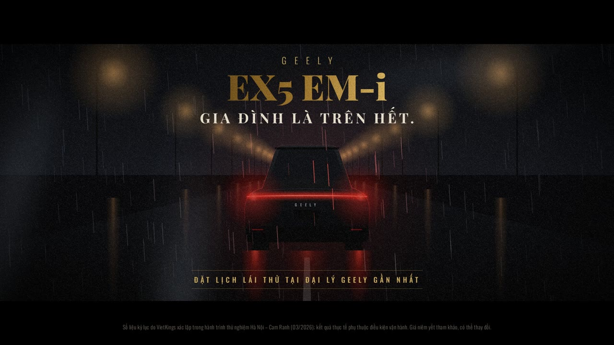

# Geely EX5 EM-i — “Ông Trùm” (phim quảng cáo 52 giây)

Phim quảng cáo ý tưởng cho **Geely EX5 EM-i**, đi theo phong cách phim mafia: ngầu, kiêu, ít lời.
Đêm mưa Sài Gòn, ánh chớp, hồ sơ mật đóng dấu đỏ, và một lời đề nghị không thể từ chối.



- **Video:** [`geely-ex5-emi-ong-trum.mp4`](./geely-ex5-emi-ong-trum.mp4): 1920×1080, 30 fps, khung 2.39:1, H.264 + AAC
- **Xem trực tiếp:** mở `index.html` trong trình duyệt (có nút phát, thanh tua, phím Space, toàn màn hình)

Toàn bộ hình ảnh được dựng bằng HTML/CSS/SVG/Canvas, gồm xe vẽ bằng SVG, mưa, khói, sấm và đèn đường vẽ bằng canvas.
Nhạc nền và hiệu ứng âm thanh được tổng hợp bằng Web Audio API. Giai điệu mandolin là sáng tác gốc, không dùng nhạc có bản quyền.

## Kịch bản

| Thời gian | Cảnh | Nội dung |
|---|---|---|
| 0:00 – 0:04 | Mở đầu | Mưa đêm. Chữ đánh máy: **SÀI GÒN / 02:00 SÁNG**. Tia chớp làm hiện bóng chiếc SUV đang đỗ. |
| 0:04 – 0:12 | Lời dẫn | *“Thành phố này có luật của nó.”* · *“Kẻ ồn ào thì nhiều.”* · *“Nhưng ông trùm thật sự… …không cần nổ máy.”* |
| 0:12 – 0:17 | Bật đèn | Cận đầu xe trong bóng tối. Hai dải LED bật lần lượt, rồi tới dải đèn ngang. Kèm tiếng “braam” và âm khởi động của xe điện. |
| 0:17 – 0:21 | Tên xe | **GEELY EX5 EM-i**, chữ mạ vàng. Dòng phụ: *SUV PLUG-IN HYBRID*. |
| 0:21 – 0:36 | Hồ sơ mật | Xe lướt trên phố mưa. Ba tập hồ sơ lần lượt bị đóng dấu **KỶ LỤC VIỆT NAM**: **228,3 km** thuần điện, **1.823,7 km** cho một lần đổ đầy, **3,02 L/100 km**. |
| 0:36 – 0:43 | Lời đề nghị | Bóng lưng ông trùm đội fedora dưới ngọn đèn. *“Tôi sẽ đưa ra một lời đề nghị… …mà anh không thể từ chối.”* Sau đó giá hiện ra: **CHỈ TỪ 789 TRIỆU** (Pro 789 · Max 909 · Ultra 969). |
| 0:43 – 0:52 | Kết | Xe rời đi trong sương, dải đèn hậu đỏ rực. **GIA ĐÌNH LÀ TRÊN HẾT.** Kêu gọi: đặt lịch lái thử. |

## Số liệu dùng trong phim

- Ba kỷ lục do VietKings xác lập trong hành trình thử nghiệm Hà Nội – Cam Ranh (03/2026): 228,3 km thuần điện, 1.823,7 km tổng quãng đường cho một lần đầy, mức tiêu hao 3,02 L/100 km.
  Nguồn: [Dân trí](https://dantri.com.vn/o-to-xe-may/geely-viet-nam-xac-lap-3-ky-luc-viet-nam-voi-dong-xe-suv-phev-geely-ex5-em-i-20260406112517233.htm), [Geely Việt Nam](https://geely.vn/tin-tuc/geely-ex5-em-i-lap-ky-luc/)
- Giá niêm yết: Pro 789 triệu, Max 909 triệu, Ultra 969 triệu.
  Nguồn: [VnExpress](https://vnexpress.net/oto-xe-may/v-car/dong-xe/geely-ex5-em-i-325), [Tuổi Trẻ](https://tuoitre.vn/geely-ex5-ra-mat-viet-nam-gia-tu-789-trieu-dong-co-the-chay-170km-khong-can-xang-20260327144615022.htm)

Cuối phim có dòng chú thích nguồn số liệu, và ghi rõ giá chỉ để tham khảo.
**Trước khi đăng chính thức, cần kiểm tra lại giá và chương trình ưu đãi hiện hành với đại lý.**

## Cấu trúc

```
index.html      Sân khấu 1920×1080: 3 góc xe SVG (ngang / trước / sau), chữ, lớp phủ, trình phát
ad.css          Giao diện chữ, hồ sơ mật, con dấu, letterbox, trình phát
ad.js           Dòng thời gian: mọi khung hình được tính từ t (giây), tua và xuất từng frame chính xác
timeline.js     Mốc thời gian dùng chung cho hình và tiếng
soundtrack.js   Nhạc + SFX tổng hợp bằng Web Audio (mưa, sấm, braam, mandolin tremolo, ostinato…)
soundtrack.m4a  Nhạc nền đã dựng sẵn cho trình phát
poster.jpg      Ảnh bìa (khung hình 0:48)
fonts/          Playfair Display, Oswald, IBM Plex Mono (SIL OFL 1.1), có bộ ký tự tiếng Việt
render/export.cjs  Xuất MP4: Playwright chụp từng frame, ffmpeg ghép hình + tiếng
```

## Xuất lại video

Cần Node 18+, [Playwright](https://playwright.dev) (Chromium) và `ffmpeg`.

```bash
cd geely-ex5-emi-ad
node render/export.cjs                         # -> geely-ex5-emi-ong-trum.mp4 + soundtrack.m4a
node render/export.cjs --fps 24 --crf 20       # tuỳ chỉnh
node render/export.cjs --stills 12.4,24,41.5   # chụp vài khung hình để duyệt
node render/export.cjs --audio-only            # chỉ dựng lại nhạc
```

Muốn sửa nội dung thì đổi chữ trong `index.html`, đổi thời điểm trong `timeline.js`, rồi chạy lại lệnh xuất.

## Lưu ý

Đây là phim quảng cáo ý tưởng (concept), không phải sản phẩm chính thức của Geely Việt Nam.
Trong phim không dùng logo chính thức, chỉ có chữ “GEELY” dựng bằng font.
Nếu dùng cho mục đích thương mại, hãy xin phép bên giữ thương hiệu.
